# Folio

**A clear lens for your money.**

Folio is a prototype money app for people whose savings are spread across too many places. It doesn't hold your cash. It sits over the banks and accounts you already use, splits every payday into purpose-built Vault Spaces, and shows you, in one calm view, where your money is and where it's heading.

**Live demo:** https://harrisongreener.github.io/folio/

On a phone it runs full screen like a real app. On a desktop browser it sits in a phone frame, with a panel of demo shortcuts beside it so you can jump straight to any screen.

<p align="center">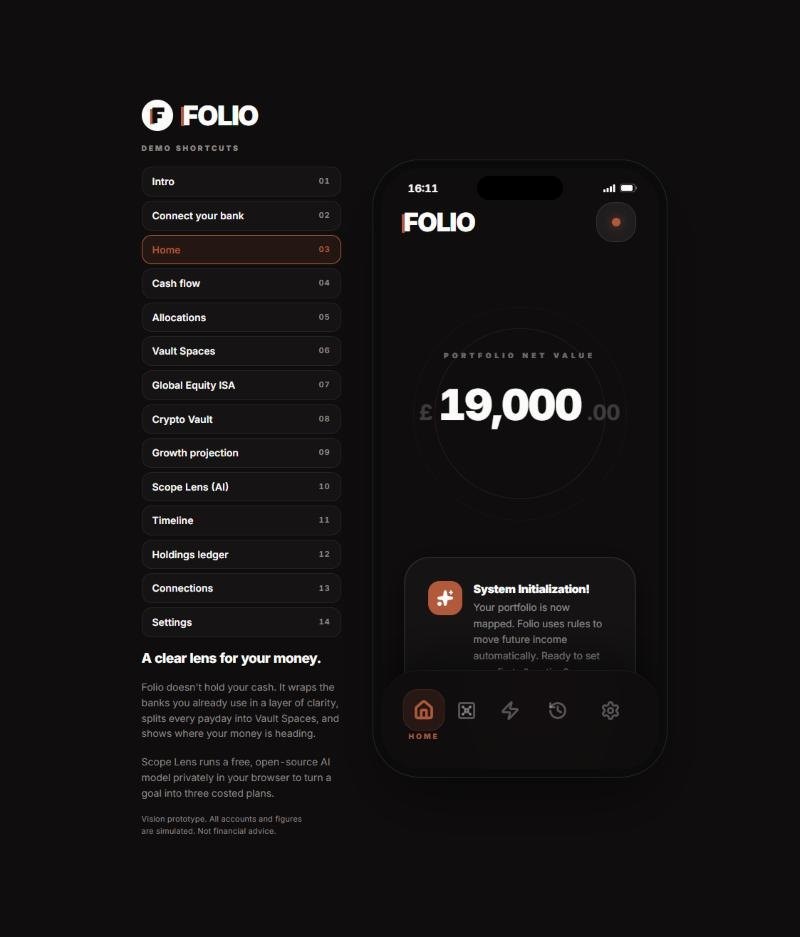</p>

---

## A look inside

<table>
<tr><td align="center" valign="top" width="25%">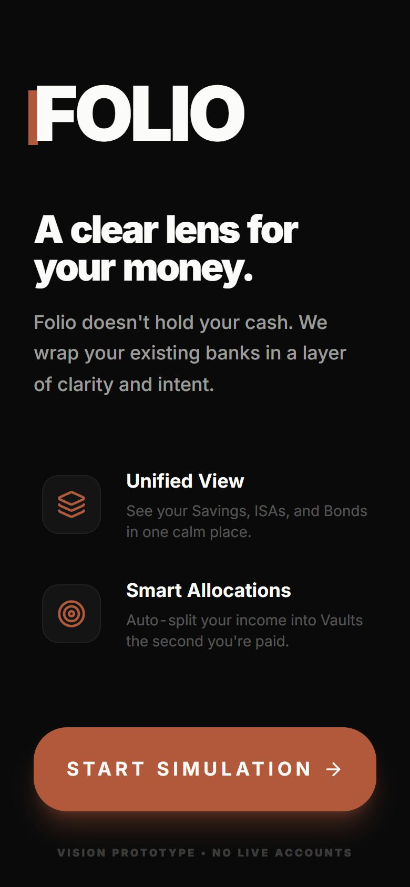<br><sub>The intro: a clear lens for your money</sub></td><td align="center" valign="top" width="25%">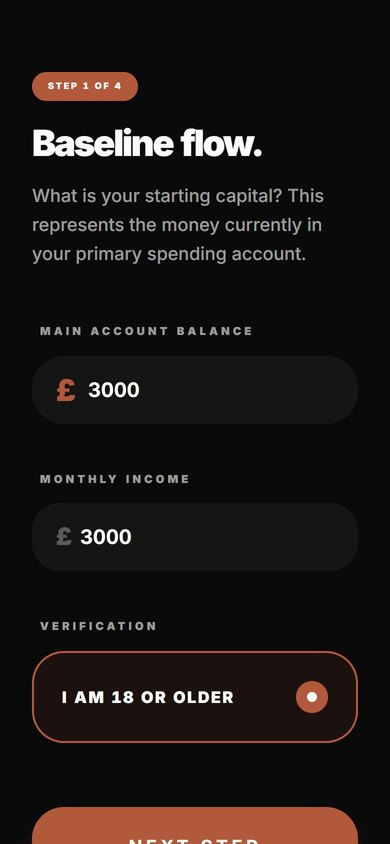<br><sub>Onboarding, step 1: your baseline flow</sub></td><td align="center" valign="top" width="25%">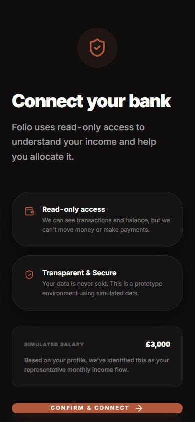<br><sub>Connecting a bank with read-only access</sub></td><td align="center" valign="top" width="25%">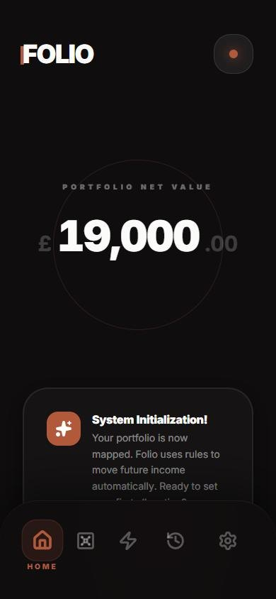<br><sub>Home: portfolio net value across every account</sub></td></tr>
<tr><td align="center" valign="top" width="25%">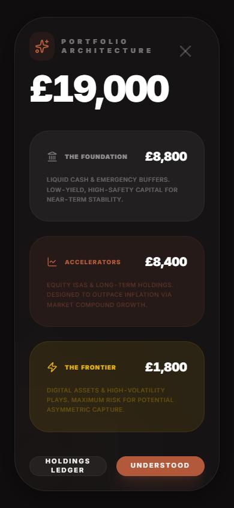<br><sub>Portfolio architecture: Foundation, Accelerators, Frontier</sub></td><td align="center" valign="top" width="25%">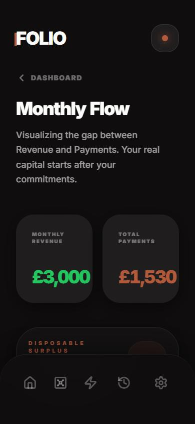<br><sub>Monthly flow: what comes in, what's committed, what's free</sub></td><td align="center" valign="top" width="25%">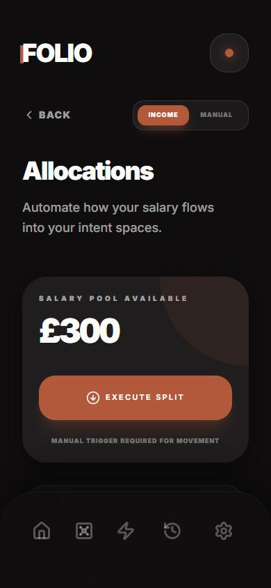<br><sub>Allocations: split each payday automatically</sub></td><td align="center" valign="top" width="25%">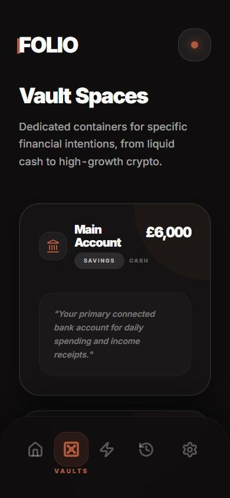<br><sub>Vault Spaces: one container per intention</sub></td></tr>
<tr><td align="center" valign="top" width="25%">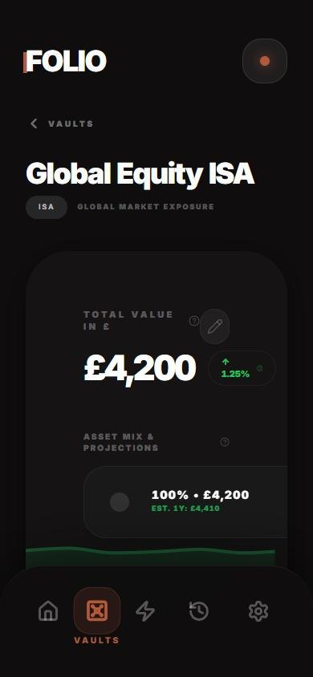<br><sub>Inside a vault: value, asset mix and projection</sub></td><td align="center" valign="top" width="25%">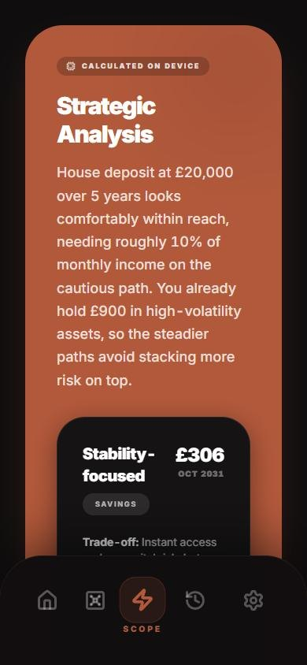<br><sub>Scope Lens: three costed plans for a goal</sub></td><td align="center" valign="top" width="25%">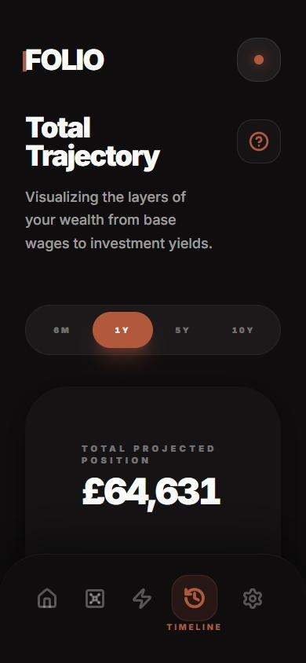<br><sub>Timeline: where today's habits take you</sub></td><td align="center" valign="top" width="25%">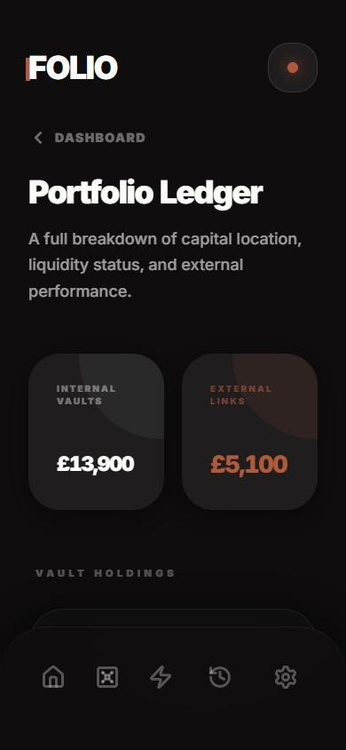<br><sub>Portfolio ledger: internal vaults and external holdings</sub></td></tr>
</table>

Screenshots are from the live demo, using its built-in demo data.

---

## Why I made it

Most people's money doesn't live in one place. There's a current account, an easy-access saver, maybe an ISA, a few Premium Bonds, some crypto in a wallet app. Each one has its own app and its own way of talking about money, so nobody gets the full picture, and "am I actually on track?" is surprisingly hard to answer.

Folio is my answer to that: **don't build another bank, build a lens.** Folio leaves your money where it is and adds a layer of clarity and intent on top. Every pound gets a job, every goal gets a monthly number, and the tone stays calm. No hype, no confetti, no pushing you towards risk.

It's a design prototype and part of my portfolio. It explores the idea, the interface and the experience, and it's honest about what is simulated (see below). Folio also has a full pitch deck.

---

## What the app does

### Getting set up
- **Four-step onboarding:** your main account balance and income, what you already hold in ISAs, bonds and crypto, your fixed commitments, and what you're aiming for.
- **Connect your bank:** a read-only connection screen that explains what Folio can and can't do with your data.

### Seeing the whole picture
- **Home:** your portfolio net value across every account, with disposable capital and commitments side by side.
- **Portfolio architecture:** tap the net value to see your money in three layers: the **Foundation** (cash and buffers), the **Accelerators** (ISAs and long-term holdings) and the **Frontier** (high-volatility assets).
- **Monthly flow:** income against payments, so you can see the surplus your plans can actually use.
- **Portfolio ledger:** internal vaults and external holdings in one list.

### Putting money to work
- **Vault Spaces:** logic containers for cash, ISAs, Premium Bonds and crypto. They aren't new bank accounts; they organise movements across the accounts you already have.
- **Vault detail:** value, asset mix, a one-year estimate and a growth projection for each space.
- **Allocations:** split a share of every payday across your vaults, with round-ups.

### Planning ahead
- **Scope Lens:** describe a goal ("house deposit, £20,000, 5 years") and get three approaches (stability, balanced and growth), each with a monthly amount, a finish date, the trade-offs and where the money should live.
- **Timeline:** your projected position from 6 months to 10 years, separating what you earn from what your investments add.

---

## Scope runs a free, open-source AI model in your browser

Scope's assistant uses [WebLLM](https://github.com/mlc-ai/web-llm) to run **Qwen 2.5 1.5B Instruct** (Apache-2.0) on your own device:

- No API key, no server and no cost.
- Nothing you type leaves your browser.
- About 1 GB downloads the first time you use Scope; after that the browser keeps it.
- It needs WebGPU (desktop Chrome or Edge, recent Safari). Anywhere else, Scope still works and shows the calculated plans instantly.

The pounds and dates are always calculated in code (`src/services/scope.ts`), and the model writes the analysis around them. Small models aren't reliable at arithmetic, so this split keeps every figure right.

---

## What is real and what is simulated

| Real | Simulated |
|---|---|
| The interface, navigation, motion and every interaction | Bank connections and account balances |
| All calculations: allocations, monthly targets, projections | Market data, 24-hour changes and prize draws |
| The Scope assistant, running a real open-source model in your browser | External wallets and providers (shown with generic names) |
| The design system from the Folio brand guide | Anything you'd need a regulated bank for |

Nothing here is financial advice. Rates in projections are assumptions, not quotes.

---

---

## Run it locally

```bash
npm install
npm run dev
```

Then open http://localhost:3000. Pushing to `main` builds and deploys to GitHub Pages automatically.

**Built with:** React 19, TypeScript, Vite, Tailwind CSS, Framer Motion, Recharts, Lucide icons and WebLLM.

---


---

Vision prototype. All accounts and figures are simulated.
